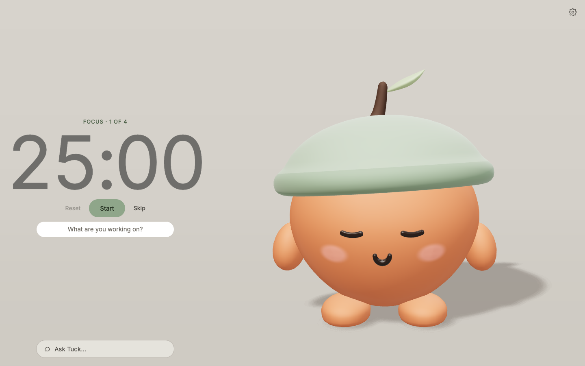

# Pocket Pal: Focus with Tuck

A calm Pomodoro timer with a tiny 3D acorn named **Tuck** who keeps you company. Tell him what you're working on and he turns it into **one small goal** that fits your session. When the timer ends he asks **"Did you finish?"** and reacts: a hop for a win, a nod for "almost", a kind head tilt for "not yet". Then he suggests the next step.

**Live:** https://pocket-pal-teal.vercel.app



## How it works

1. **Start with an intention.** Type "my history essay" and press Start. The timer starts at once, and Tuck replies with a goal like *Draft the intro paragraph*. It's sized to your real focus length (25 minutes by default, or whatever you set).
2. **Focus.** Tuck sits and works quietly beside you. If you get stuck, open **Ask Tuck** and tap **I'm stuck**, **I'm distracted** or **Plan this session**. Each chip sends on one tap.
3. **Check in.** When the session ends, answer **Yes / Almost / Not yet**. Tuck reacts with his body first, then says a line and suggests the next goal. Your next Start reuses that goal, with no extra AI call.

The timer is timestamp-based, so it survives reloads, background tabs and sleep. It runs 25/5/15 with a long break after 4 sessions, all adjustable. Notifications and the chime are opt-in.

## The AI: an open-weight model at the core

- **Model:** [`openai/gpt-oss-20b`](https://huggingface.co/openai/gpt-oss-20b), an open-weight model under Apache-2.0, served by [Groq](https://groq.com) through its OpenAI-compatible API. If the main model is rate-limited, the server tries `openai/gpt-oss-120b` once.
- **Structured output:** each reply is a strict JSON schema: `line` (what Tuck says), `answer` (optional short help), `goal`, `emotion`, `action` and `memory_candidate`. The server validates it with zod and trims anything too long. It never shows raw model text.
- **Small by design:**
  - A request is about 900 prompt tokens, and replies are capped at 450 tokens.
  - There are about 2 calls per Pomodoro: one at Start and one at the check-in.
  - Groq's free tier is shared by every user of the app (8,000 tokens a minute and 1,000 requests a day for gpt-oss-20b), so every call counts.
- **The body belongs to the app:** the model can suggest a mood, but Tuck's check-in reactions are chosen by the app from your answer. The animation clips come from a fixed allowlist, so the model can never make him do something odd.
- **Reliability:**
  - gpt-oss sometimes tries to call a tool that doesn't exist, and Groq rejects that with 400 `tool_use_failed`. The server resamples once, cooler and as a forced call to a single `tuck_reply` function.
  - Rate limits and timeouts fail fast with in-character lines ("Phew, I need a quick breather") and a **Try again** button.
  - Error codes go to the server logs only.
- **Guardrails in the prompt:**
  - Asking Tuck to write your essay gets an offer to outline it together.
  - "I'm stressed and want to quit" gets a warm suggestion for a breather or a smaller goal.
  - Off-topic questions get a gentle redirect.
- **Privacy:** chat is kept for this visit only. Tuck remembers a fact only after you tap ✓, and it's stored on your device.

### Run the same model locally (untested)

`AI_BASE_URL` points the app at any OpenAI-compatible server, for example Ollama or LM Studio running `gpt-oss:20b`. A local server needs no key. I haven't tested this path yet, and support for strict JSON schemas and forced tool calls varies by server.

```bash
AI_BASE_URL=http://localhost:11434/v1 GROQ_MODEL=gpt-oss:20b npm run dev
```

## Tech stack

- **App:** Next.js 15 (App Router), React 19, TypeScript, Tailwind CSS 4.
- **3D:** three.js, React Three Fiber and drei. Tuck was modelled and rigged in Blender and exported as a GLB, with a procedural fallback model. The studio room is an infinity-cove mesh; the camera frames Tuck with a view offset so the room continues behind the timer.
- **State:** Zustand, with zod-validated `localStorage` for the timer, settings and opt-in memory.
- **AI:** Groq (`gpt-oss-20b`, fallback `gpt-oss-120b`), called from a Next.js route handler. The handler checks the origin, limits each IP and device (30 per minute, 500 per day), and never exposes the key to the browser.
- **Tests:** Vitest unit tests, plus Playwright end-to-end runs in Chromium and WebKit for desktop and phone layouts.
- **Hosting:** Vercel.

## Setup

```bash
npm install
echo "GROQ_API_KEY=your-key" > .env.local   # server only; never commit it
npm run dev                  # http://localhost:3000
```

| Variable | Purpose |
|---|---|
| `GROQ_API_KEY` | Groq key (server only). Without it, Tuck says his brain is napping. |
| `GROQ_MODEL` | Main model, default `openai/gpt-oss-20b`. |
| `GROQ_FALLBACK_MODEL` | Used once when the main model is rate-limited. Default `openai/gpt-oss-120b`; set it to empty to disable. |
| `AI_BASE_URL` | Any OpenAI-compatible endpoint (local Ollama / LM Studio). Default is Groq. |
| `AI_ENABLED` | Set to `false` to turn the AI off. |

### Tests

```bash
npx tsc --noEmit && npx vitest run
npm run build && npx next start -p 3107
node scripts/study-e2e.mjs      # in another terminal: timer, Tuck's moments, the focus loop, Ask Tuck
```

Routes: `/` picks the layout by orientation, `/desk` and `/pocket` force one, and `?time=23:48` previews time-of-day behaviour.
